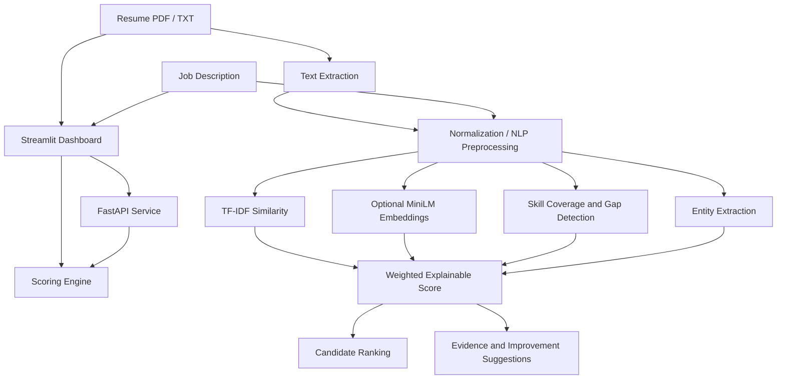

<div align="center">

# 📄 ResumeIQ
### *Explainable AI for Resume–Job Matching*

Turn resumes into actionable hiring insights.

[](https://resumeiq2.streamlit.app/)


</div>

---

## 🎯 Overview

ResumeIQ is an explainable AI-assisted applicant-tracking prototype that scores and ranks resumes against a job description. It combines lexical similarity, semantic embeddings, skill-gap detection, entity extraction, and recruiter-adjustable weights to produce an interpretable 0–100 score.

The system also diagnoses resume weaknesses, suggests quantified X-Y-Z improvements, audits power verbs and metrics, and generates tailored sample resume templates.

**Try the live application:** [resumeiq2.streamlit.app](https://resumeiq2.streamlit.app/) · **Source code:** [GitHub repository](https://github.com/Ankitkumar06102005/ResumeIQ)

## ✨ Key capabilities

- **Resume ingestion:** accepts PDF and TXT resumes alongside a job description.
- **Explainable matching:** reports an overall score with skill coverage, semantic similarity, and other extracted signals.
- **Gap analysis:** surfaces matched and missing skills to guide resume tailoring.
- **Batch ranking:** compares multiple resumes against one role.
- **Configurable scoring:** adjust scoring weights for skills, experience, and education.
- **Advisor insights:** presents improvement suggestions and tailored sample content; candidates should verify every suggested claim before using it.

## 🧠 Architecture



## 🔄 Processing workflow

1. **Ingest:** upload one or multiple resumes and provide a job description.
2. **Extract:** parse PDF/TXT content into normalized text.
3. **Represent:** compute lexical features with TF-IDF and optionally semantic vectors with `all-MiniLM-L6-v2`.
4. **Compare:** evaluate keyword coverage, semantic similarity, skills, entities, experience, and education signals.
5. **Score:** combine enabled signals using recruiter-controlled weights into an explainable 0–100 score.
6. **Rank:** sort candidates and expose matched and missing evidence.
7. **Improve:** display diagnosis and suggestions for the user to review and validate.

## 🧪 Modeling phases

| Phase | Implementation |
|---|---|
| 1 | TF-IDF, keyword overlap, classical classifiers, cross-validation, confusion matrices |
| 2 | `all-MiniLM-L6-v2` embeddings and skill-gap detection |
| 3 | Regex NER with optional DistilBERT NER training utility |
| 4 | Streamlit dashboard, uploads, adjustable weights, multi-resume ranking |
| 5 | FastAPI endpoints |
| 6 | AI diagnosis, X-Y-Z suggestions, metrics/power-verb audit, tailored templates |

## 📊 Phase 1 benchmark

These are the project's previously recorded Phase 1 benchmark values, not live production measurements.

| Model | Accuracy | Precision | Recall | F1 |
|---|---:|---:|---:|---:|
| Logistic Regression | 0.7565 | 0.7865 | 0.7042 | 0.7431 |
| Random Forest | 0.8179 | 0.8319 | 0.7968 | 0.8140 |
| XGBoost | 0.8159 | 0.8369 | 0.7847 | 0.8100 |

## 🔌 API

| Method | Endpoint | Purpose |
|---|---|---|
| GET | `/health` | Service health |
| POST | `/score` | Score one resume/job-description pair |
| POST | `/rank` | Rank multiple candidates |
| POST | `/score-pdf` | Score an uploaded PDF resume |

Interactive API docs when running locally: `http://127.0.0.1:8000/docs`.

## 🚀 Quick start

Create and activate a virtual environment, then install the project dependencies:

```bash
python -m venv .venv
# Windows PowerShell
.venv\Scripts\Activate.ps1
pip install -r requirements.txt
```

Launch the Streamlit UI:

```bash
streamlit run app/streamlit_app.py
```

Run the API separately:

```bash
uvicorn src.api:app --reload --port 8000
```

Run the test suite:

```bash
python -m pytest tests -v -p no:cacheprovider
```

Optional training dependencies:

```bash
pip install -r requirements-training.txt
```

## 📁 Structure

```text
app/                 Streamlit recruiter dashboard
src/                 scoring, API, NLP, and training modules
tests/               API contract and scoring integration tests
data/processed/      generated training and evaluation outputs
models/              serialized model artifacts
```

## ⚖️ Responsible-use note

ResumeIQ is a decision-support tool. Recruiters should validate outputs, inspect the underlying evidence, and avoid using an automated score as the sole basis for employment decisions. AI-generated suggestions are drafts and should never introduce experience, skills, or achievements that a candidate cannot substantiate.

---

<div align="center">

[🚀 Open ResumeIQ Live](https://resumeiq2.streamlit.app/) · [💻 View the source on GitHub](https://github.com/Ankitkumar06102005/ResumeIQ)

</div>
